# Ragesh L

  

I build AI and data tools that help people find information and automate repetitive work. My background is in **Artificial Intelligence and Data Science** at CK College of Engineering & Technology. At Cavin InfoTech, I worked on data exploration and AI workflows for weather and news applications.

  

## Featured projects

### All Career

Job discovery and interview practice for candidates in India. The platform gathers listings from job boards, company career pages, Telegram, and hiring flyers. It brings job filters, walk-in interviews, and company-specific coding practice into one dashboard.

 

### NeuralRAG · Production-Level RAG

A self-hosted Python and FastAPI workspace for asking questions about uploaded documents. It combines document retrieval and reranking with live web search and API-provider failover.

### AutoFill V7

A Manifest V3 Chrome extension for recording and replaying browser workflows. It reuses saved form answers and can use a configured AI provider for unfamiliar fields. All Career can hand job application batches to the extension.

## Skills

